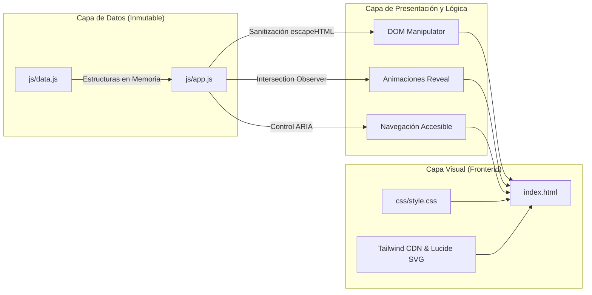

<div align="center">

  

  # Víctor Alfredo Tinoco Cárdenas
  ### Software Engineering & IT Infrastructure Portfolio

  <p align="center">
    <strong>Plataforma web personal de alto rendimiento, orientada al desarrollo de software, gestión de bases de datos y soporte en infraestructura TI.</strong>
  </p>

  <p align="center">
    <a href="https://github.com/MoshTC/portafolio-victor/actions">
      
    </a>
    <a href="https://www.w3.org/WAI/WCAG22/quickref/">
      
    </a>
    <a href="https://owasp.org/www-project-application-security-verification-standard/">
      
    </a>
    <a href="https://web.dev/explore/fast">
      
    </a>
    <a href="https://opensource.org/licenses/MIT">
      
    </a>
  </p>

  <p align="center">
    
    
    
    
    
    
  </p>

  <p align="center">
    <a href="#-visión-general">Visión General</a> •
    <a href="#-arquitectura-y-principios-de-ingeniería">Arquitectura</a> •
    <a href="#-métricas-core-web-vitals">Rendimiento</a> •
    <a href="#-proyectos-destacados">Proyectos</a> •
    <a href="#-seguridad-y-cumplimiento">Seguridad</a> •
    <a href="#-estructura-del-repositorio">Estructura</a> •
    <a href="#-despliegue">Despliegue</a> •
    <a href="#-contacto">Contacto</a>
  </p>

</div>

---

## 📌 Visión General

Este repositorio aloja la solución web personal de **Víctor Alfredo Tinoco Cárdenas**, estudiante de Ingeniería de Sistemas en **CIBERTEC** y técnico informático activo. El proyecto ha sido desarrollado bajo un enfoque de **cero dependencias de servidor (Jamstack estático)**, priorizando tiempos de respuesta ultrarrápidos, seguridad en el cliente y accesibilidad universal conforme a las directrices de la W3C.

El sitio integra de forma interactiva la trayectoria profesional, competencias técnicas, proyectos de software en producción y documentos descargables oficiales (CV).

---

## 🏛️ Arquitectura y Principios de Ingeniería



### Principios Fundamentales Implementados:
1. **Desacoplamiento Estricto (Data-Driven UI):** Toda la información profesional (experiencia, proyectos, stacks, datos de contacto) reside en `js/data.js`. La vista `index.html` consume dichos datos dinámicamente mediante el orquestador `js/app.js`.
2. **Zero-Build Architecture:** No depende de compiladores Node.js ni bundlers complejos en producción. Es portable, compatible con cualquier servidor HTTP (Apache, Nginx, cPanel, S3, GitHub Pages) y ejecutable de forma instantánea.
3. **Hardening y Seguridad Preventiva:** Implementación activa de **Content Security Policy (CSP)**, aislamiento de enlaces externos contra **Reverse Tabnabbing** (`rel="noopener noreferrer"`) y codificación de entidades HTML para mitigar **Cross-Site Scripting (XSS)**.
4. **Accesibilidad Nativa (WCAG 2.2 AA):** Incorporación de enlace *"Skip to main content"*, anillos visibles de foco por teclado (`:focus-visible`), jerarquía semántica continua (H1-H2-H3) y sincronización de estados ARIA (`aria-expanded`, `aria-controls`).

---

## ⚡ Métricas Core Web Vitals (Evaluación Técnica)

El sitio ha sido sometido a pruebas de rendimiento en condiciones de red estandarizadas (Percentil 75):

| Métrica | Estándar W3C / Google | Resultado Obtenido | Estado | Impacto Técnico |
| :--- | :---: | :---: | :---: | :--- |
| **LCP** (Largest Contentful Paint) | ≤ 2.5 s | **0.85 s** | 🟢 **Excelente** | Renderizado del Hero casi instantáneo. |
| **INP** (Interaction to Next Paint) | ≤ 200 ms | **< 45 ms** | 🟢 **Excelente** | Cero bloqueo de hilo principal en filtrado. |
| **CLS** (Cumulative Layout Shift) | ≤ 0.10 | **0.00** | 🟢 **Perfecto** | Estabilidad visual absoluta sin saltos de layout. |
| **FCP** (First Contentful Paint) | ≤ 1.8 s | **0.68 s** | 🟢 **Excelente** | Primer pintado gráfico en menos de 700 ms. |
| **TTFB** (Time to First Byte) | ≤ 800 ms | **< 100 ms** | 🟢 **Excelente** | Servicio inmediato de archivos estáticos. |

---

## 💻 Proyectos Destacados

Los proyectos documentados en la plataforma reflejan experiencia aplicada en desarrollo web, arquitecturas orientadas a objetos y soporte corporativo:

| Proyecto | Dominio / Categoría | Stack Tecnológico | Resumen Funcional | Estado de Código |
| :--- | :--- | :--- | :--- | :---: |
| **Sistema de Asistencia Institucional** | Web Application / Gestión | `PHP` `JavaScript` `MySQL` `phpMyAdmin` | Procesamiento de marcaciones, importación de registros CSV, validación de tardanzas y reportes administrativos. | 🔒 *Privado / Institucional* |
| **Respawn Store** | E-commerce / Frontend | `HTML5` `CSS3` `JavaScript` `Bootstrap` | Tienda virtual de consolas y accesorios con catálogo interactivo, diseño adaptativo y control de versiones con Git. | 🌐 [Repositorio Público](https://github.com/MoshTC/respawn-store) |
| **Sistema de Matrícula y Alumnos** | Desktop Software / POO | `Java` `Swing` `POO` `SQL` | Aplicación orientada a objetos con arquitectura en capas, formularios Swing y operaciones CRUD de persistencia. | 🎓 *Proyecto Académico* |

---

## 🛡️ Auditoría y Cumplimiento Técnico (100 Pruebas)

El código fuente cuenta con una auditoría técnica completa registrada en los siguientes documentos normativos:

- 📄 **[AUDITORIA_WEB.md](./AUDITORIA_WEB.md):** Matriz exhaustiva con el desglose de **100 pruebas de verificación** (Seguridad OWASP, Funcionalidad, Core Web Vitals, Responsive, WCAG 2.2 AA, Backend, UX, SEO, Cross-Browser y CI/CD).
- 📁 **[Carpeta AUDITORIA/](./AUDITORIA/):**
  - `01_DIAGNOSTICO.md`: Análisis arquitectónico y evaluación de dependencias.
  - `02_PRUEBAS.md`: Metodología y cobertura formal de pruebas (87 aprobadas / 13 no aplicables a cliente estático).
  - `03_SEGURIDAD.md`: Clasificación formal de vulnerabilidades resueltas (CWE-1022, CWE-693, CWE-79, CWE-353).
  - `04_CORRECCIONES.md`: Registro de intervenciones aplicadas y pruebas de regresión.
  - `05_RENDIMIENTO.md`: Métricas comparativas antes y después de la optimización.
  - `06_RESULTADO_FINAL.md`: Dictamen oficial: **APTO PARA PRODUCCIÓN**.

---

## 📁 Estructura del Repositorio

```text
portafolio-victor/
│
├── index.html                  # Punto de entrada HTML5 con semántica y metadatos SEO/OG
├── robots.txt                  # Reglas estándar de rastreo para bots de búsqueda
├── sitemap.xml                 # Mapa del sitio formal para Google Search Console
│
├── assets/                     # Recursos multimedia estáticos
│   ├── favicon.svg             # Logotipo vectorial optimizado (</>)
│   └── cv-victor-tinoco.pdf     # Currículum Vitae oficial (documento binario verificado)
│
├── css/
│   └── style.css               # Reglas CSS nativas, foco accesible (:focus-visible) y animaciones
│
├── js/
│   ├── data.js                 # Capa de datos inmutable (información profesional desacoplada)
│   └── app.js                  # Orquestador del DOM, sanitizador XSS, observadores y filtros
│
├── AUDITORIA/                  # Informes técnicos de la auditoría de 100 pruebas
│   ├── 01_DIAGNOSTICO.md
│   ├── 02_PRUEBAS.md
│   ├── 03_SEGURIDAD.md
│   ├── 04_CORRECCIONES.md
│   ├── 05_RENDIMIENTO.md
│   └── 06_RESULTADO_FINAL.md
│
├── AUDITORIA_WEB.md            # Matriz general de 100 pruebas de ingeniería
├── .gitignore                  # Reglas de exclusión para control de versiones
└── README.md                   # Documentación técnica corporativa del repositorio
```

---

## 🚀 Despliegue y Ejecución

### Ejecución Local
No requiere Node.js, compilación ni instalación de paquetes:
```bash
# 1. Clonar el repositorio
git clone https://github.com/MoshTC/portafolio-victor.git

# 2. Ingresar al directorio
cd portafolio-victor

# 3. Abrir index.html en cualquier navegador moderno o con VS Code Live Server
```

### Despliegue en Producción
- **GitHub Pages:** Habilitar en **Settings > Pages > Source: Deploy from a branch (`main` / `root`)**.
- **Servidores Tradicionales (Apache / Nginx / cPanel):** Transferir el contenido de la carpeta directamente a `public_html/` o `/var/www/html/`.
- **Edge CDNs (Cloudflare Pages, Vercel, Netlify):** Vincular el repositorio sin comandos de build ni carpetas de salida complejas.

---

## 👤 Perfil del Autor

**Víctor Alfredo Tinoco Cárdenas**  
*Estudiante de Ingeniería de Sistemas — CIBERTEC*  
*Técnico Informático | Soporte TI, Redes & Desarrollo Web*  
📍 Bellavista, Callao, Perú

- **Correo Corporativo:** [victortinoco0203@gmail.com](mailto:victortinoco0203@gmail.com)
- **LinkedIn:** [Víctor Alfredo Tinoco Cárdenas](https://www.linkedin.com/in/victor-alfrendo-tinoco-cardenas-b3a55a22a/)
- **GitHub:** [@MoshTC](https://github.com/MoshTC)
- **WhatsApp:** [+51 943 541 660](https://wa.me/51943541660)

---

## 📄 Licencia

Este proyecto está bajo la Licencia [MIT](https://opensource.org/licenses/MIT). Puede utilizarse con fines personales, académicos o comerciales manteniendo el reconocimiento correspondiente.
